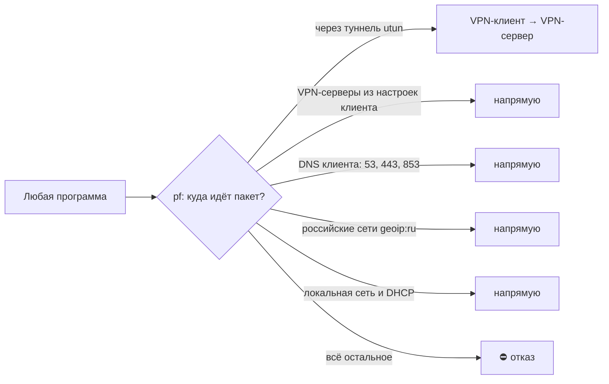

<div align="center">

# 🛡️ VPN Guard

**Страховка VPN для macOS: зарубежный трафик — только через туннель VPN.**

[](#что-нужно)
[](#vpn-клиенты)
[](#как-работает)
[](LICENSE)

</div>

> **In English.** VPN Guard is a kill switch for macOS. While it is on, traffic to foreign addresses leaves the Mac only through the VPN tunnel. If the VPN drops, fails to start after a reboot or is simply forgotten, nothing leaks: DNS and every non-allowed destination are blocked, the local network keeps working. It uses the built-in `pf` firewall with destination-only rules (no per-process matching), a root watchdog that restores the rules, and a menu bar app with pause and notifications. VPN server addresses are taken from the VPN client automatically through a small adapter: [Karing](https://github.com/KaringX/karing) is supported out of the box, other clients can be added by a coding agent following [AGENTS.md](AGENTS.md). Documentation is in Russian.

---

## Зачем

VPN может оборваться на секунду, не подняться после перезагрузки или остаться выключенным, потому что про него забыли. Иногда хватает одного запроса с реального IP, чтобы аккаунт в зарубежном сервисе попал под риск.

Пока VPN Guard включён, зарубежные адреса доступны **только через туннель VPN**. VPN выключен или упал — всё зарубежное и DNS закрыты. Локальная сеть (роутер, принтер, AirDrop) работает всегда.

Это страховка VPN, а не его замена.

## Возможности

- 🔒 **Fail-closed.** Нет туннеля — нет интернета за рубеж. Нельзя забыть и «поработать пять минут без VPN».
- 🇷🇺 **Российские сайты — напрямую**, по списку `geoip:ru` — тому же, по которому их пускает напрямую Karing.
- 🔁 **Адреса серверов — из VPN-клиента сами.** Сменил профиль или подписку — защита подхватит адреса и пришлёт уведомление о новом сервере.
- 🐕 **Сторож** раз в 2 секунды проверяет правила и чинит их, если их кто-то снёс. После перезагрузки защита всегда включена.
- 🔑 **Снять защиту — только с паролем администратора.** Программы и AI-агенты, которые работают от вашего имени, сами её не выключат. Включить — без пароля.
- ⏸ **Пауза** на 15 минут или выбранный срок — потом защита вернётся сама.
- 🧯 **Аварийный набор.** Не загрузились полные правила — работает урезанный, но безопасный набор (туннель и локалка), и приходит уведомление. Никогда — «всё открыто».
- 🧩 **Адаптеры VPN-клиентов.** Ядро от клиента не зависит; под новый клиент нужен один файл, и его может написать кодинг-агент по [AGENTS.md](AGENTS.md).
- 🧹 **Чистое удаление.** `/etc/pf.conf` не меняется, правила живут в своём якоре; `vpnguard uninstall` возвращает pf как было.

## VPN-клиенты

| Клиент | Адаптер | Состояние |
|---|---|---|
| [Karing](https://github.com/KaringX/karing) (режим TUN) | `karing` | ✅ основной клиент, на нём проверялась защита |
| ваш клиент | `providers/ИМЯ/` | 🧩 дайте кодинг-агенту [AGENTS.md](AGENTS.md) |

Подходит любой клиент, который на macOS поднимает туннель (`utun`, `ipsec`, `ppp`). Интерфейс адаптера — в [docs/ADAPTERS.md](docs/ADAPTERS.md).

## Как работает



- **Правила встроенного файрвола macOS (`pf`) — только по интерфейсу и адресу назначения.** Защита не спрашивает, какая программа шлёт пакет: проверки владельца в pf (`user`, `group`) — редкий механизм, рискованный для ядра, и установщик их не пропустит.
- **Адаптер клиента** (`providers/ИМЯ/provider.sh`) знает, где у клиента настройки. Значок в строке меню раз в 10 секунд берёт через него адреса серверов и DNS и передаёт сторожу. Сторож проверяет каждую строку, а имена серверов разрешает сам — через публичный DNS по HTTPS (Cloudflare, Google), не через настройки клиента.
- **Сторож** — фоновая служба от root (LaunchDaemon). Каждый вызов `pfctl` — с таймаутом: если pf не отвечает 10 секунд, приходит уведомление «сохрани работу».
- **Команда `vpnguard`** делает всё то же самое из терминала.

## Что нужно

- **macOS 15 или новее** (нужен встроенный `/usr/bin/jq`) и права администратора.
- **VPN-клиент, который поднимает туннель**, и адаптер под него. Для Karing:
  - режим системного VPN (TUN) — при подключении появляется интерфейс `utunN`. Проверено на Karing 1.2.24;
  - **выключены прямые правила региона по доменам (geosite), правила по IP (geoip) включены.** Иначе российский сайт на зарубежном хостинге Karing попробует открыть напрямую, защита не пустит, и сайт не откроется. Переключатель называется «Автоматически добавлять основные правила»; не нашли — `providers/karing/geosite-off.sh` сделает это сам (сначала копия настроек; `--check` — только показать).
- **Xcode Command Line Tools** — из исходника собирается значок в строке меню: `xcode-select --install`.

## Установка

1. **Склонируйте репозиторий именно в `~/Tools/vpnguard`** — на этот путь ссылаются подсказки и `vpnguard update`:
   ```bash
   git clone https://github.com/boss707ai/vpnguard.git ~/Tools/vpnguard
   cd ~/Tools/vpnguard
   ```
2. **Проверка совместимости** — VPN подключён, пароль не нужен, ничего не меняет:
   ```bash
   ./precheck.sh                      # Karing
   ./precheck.sh --provider ИМЯ       # другой адаптер из providers/
   ```
   В конце должно быть `ВЫВОД: совместимо`. Есть «СТОП» — исправьте и запустите снова.
3. **Установка:**
   ```bash
   sudo ./install.sh                  # Karing
   sudo ./install.sh --provider ИМЯ   # другой адаптер
   ```
   Установщик всё проверяет, показывает, что именно попадёт в систему, и ставит только после `y`. При первой установке пролетит около 15 тысяч строк — в основном список российских сетей, вопрос будет в конце. Итог: `Защита: ВКЛЮЧЕНА · VPN работает`, в строке меню — щит с галочкой. macOS спросит, можно ли VPN Guard читать данные клиента, — «Разрешить».
4. **Приёмка на вашей машине** (минут пять, по ходу попросит выключить и включить VPN):
   ```bash
   sudo "/Library/Application Support/VPNGuard/tests/acceptance.sh" --vpn-off
   ```
   В конце должно быть `FAIL=0`.
5. *По желанию* — **обкатка под нагрузкой**, без пароля, число — часы:
   ```bash
   bash "/Library/Application Support/VPNGuard/tests/soak.sh" 12 --docker
   ```

## Пользование

Подробно — в [ПАМЯТКА.md](ПАМЯТКА.md), она же открывается из меню значка.

| Значок | Что значит |
|---|---|
| щит с галочкой | защита включена, VPN работает |
| щит с «!» | VPN выключен — интернет закрыт. Включите VPN |
| ⏸ 12:34 | пауза; через столько защита вернётся сама |
| перечёркнутый щит | защита выключена до «Включить» или перезагрузки |
| щит, закрашенный наполовину | защита работает не целиком — подсказка в меню |
| треугольник «!» | сторож не отвечает (на пару секунд после пробуждения Mac это нормально) |
| восьмиугольник «!» | pf не отвечает — сохраните работу и перезагрузите Mac |

```bash
vpnguard status | test | log [N] | on
vpnguard sync                 # взять адреса серверов из VPN-клиента сейчас (иконка делает это сама)
vpnguard pause [15m|30m|1h]   # спросит пароль
vpnguard off                  # спросит пароль
vpnguard update               # обновление из ~/Tools/vpnguard: покажет diff и спросит «y»
vpnguard uninstall            # удалить всё, pf как до установки
```

## Безопасность

- Всё, что работает от root, — сторож, команда, адаптер, значок с окном пароля — лежит в `/Library/Application Support/VPNGuard/`, туда пишет только root.
- Обновление идёт только через установленную копию установщика: полный diff всего, что попадёт в систему, и установка только после `y`. Файлы с невидимыми символами и буквами-двойниками не принимаются; в правилах pf пропускаются только известные виды строк.
- Сторож раз в 5 минут ищет у чужих программ правила pf с проверкой владельца и сообщает, если нашёл.

**Чего защита не закрывает:**
- российские сети открыты напрямую для всех программ (по голому IP; по имени при выключенном VPN не откроется — DNS закрыт);
- DNS-серверы из настроек клиента и резолверы защиты (1.1.1.1, 8.8.8.8) открыты напрямую на портах DNS;
- настройки VPN-клиента может поменять любая ваша программа — от подлога страхует уведомление «добавлен VPN-сервер…»;
- до 2 секунд, если чужая программа снесёт правила (сторож вернёт).

**Побочные эффекты:** пока защита включена, Mac не раздаёт интернет; при выключенном VPN не синхронизируются часы.

## Если что-то не так

- `vpnguard status` — состояние, `vpnguard log` — журнал: починки, уведомления, кто и когда снимал защиту.
- Интернета нет — значит, VPN выключен. Включите его или поставьте паузу в меню.
- VPN не подключается при включённой защите — проверьте в `vpnguard status` строку «VPN-серверы». Пусто — `vpnguard sync`.
- Не помогло — откройте [issue](https://github.com/boss707ai/vpnguard/issues) и приложите `vpnguard status` и `vpnguard log`.
- Полное удаление: `vpnguard uninstall`.

## Свой VPN-клиент

Откройте кодинг-агента (Claude Code, Codex, Cursor) в папке репозитория и дайте ему:

```
Прочитай AGENTS.md и сделай адаптер VPN Guard под мой VPN-клиент: [НАЗВАНИЕ].
Начни с разведки: дай мне команды без sudo, я пришлю вывод.
```

Агент сделает `providers/ИМЯ/provider.sh` и тесты к нему, ядро не трогает. Установку и приёмку запускаете вы. Готовым адаптером можно поделиться через pull request.

## Windows

Готовой версии для Windows нет. В [WINDOWS.md](WINDOWS.md) — план адаптации: требования, варианты на штатных механизмах Windows, подводные камни, приёмка и готовый промт для нейросети.

## Для разработчиков

Тесты без root:

```bash
bash tests/test_state.sh       # общие функции, разбор выжимки, контракт адаптеров, адаптер Karing
bash tests/test_daemon_sim.sh  # симуляция сторожа и CLI с заглушками pfctl, sudo, curl
bash tests/test_textcheck.sh   # проверка текста файлов тем же кодом, что в install.sh
```

Список российских сетей `pf/ru.cidr` собирается из того же файла, по которому решает Karing (`geoip/ru.srs` внутри Karing.app). Пришло уведомление «Karing обновил список российских IP» — пересоберите список и обновите защиту:

```bash
python3 tools/srs2cidr.py > pf/ru.cidr
vpnguard update
```

<details>
<summary>Структура репозитория</summary>

| Путь | Что это |
|---|---|
| `pf/vpnguard.rules` | правила pf; таблицы адресов дописывает сторож |
| `pf/ru.cidr` | российские IPv4-сети (`geoip:ru` из Karing) |
| `daemon/vpnguardd` | сторож (LaunchDaemon от root) |
| `cli/vpnguard` | команда `vpnguard` |
| `lib/state.sh` | общие функции |
| `providers/ИМЯ/` | адаптеры VPN-клиентов; `providers/karing/` — Karing и его утилиты |
| `app/` | значок в строке меню (Swift) |
| `launchd/` | описания служб launchd |
| `install.sh`, `uninstall.sh` | установка и удаление |
| `precheck.sh` | проверка совместимости до установки |
| `tools/srs2cidr.py` | список сетей из `.srs` sing-box |
| `tests/` | тесты, приёмка (`acceptance.sh`), обкатка (`soak.sh`) |
| `docs/ADAPTERS.md`, `AGENTS.md` | интерфейс адаптера и инструкция для кодинг-агента |

</details>

## Лицензия

[MIT](LICENSE). Проект не связан с разработчиками Karing. Это страховка, а не гарантия: проверьте защиту на своей машине приёмочным тестом.
